# SWS405 – Unit VII Practical Report

**Static and Dynamic Malware Analysis Using Kali Linux (Harmless Ransomware-Behaviour Simulator)**

Student name: ____________________  
Student ID: ____________________  
Date: 20 November 2026

---

## 1. Objective

The objective of this practical was to analyse a harmless, instructor-supplied ransomware-behaviour simulator using both static and dynamic techniques. The practical covered identifying a file by its real format, calculating hashes, extracting strings, inspecting the file header, matching a YARA rule, executing the sample in a controlled environment, and comparing static predictions with dynamic observations. The findings were then recorded as training indicators of compromise (IOCs).

## 2. Environment and Safety

The practical was carried out in a Kali Linux virtual machine (kernel 6.16.8+kali-amd64) running in UTM. The sample was a harmless Python script (`suspicious_sample.py`) that only created dummy files inside a `lab_workspace` folder. It did not encrypt, rename, delete or transmit any file. The sample was kept in a dedicated lab directory (`~/SWS405_MalwareLab`) and was executed only once. A VM snapshot was taken before the dynamic analysis, and the sample hash was recorded before analysis so that integrity could be verified afterwards.

The files used were:

| File | Purpose |
| --- | --- |
| `suspicious_sample.py` | The harmless ransomware-behaviour simulator (the sample) |
| `sws405_ransom_simulator.yar` | The YARA detection rule |
| `national.exe.pdf` | A text script with a misleading name, used to demonstrate file identification |

## 3. Lab Setup

### 3.1 Working directory

The working directory `~/SWS405_MalwareLab` was created, and the sample, the YARA rule and `national.exe.pdf` were copied into it from the extracted ZIP. The directory listing confirmed that all three files were present.

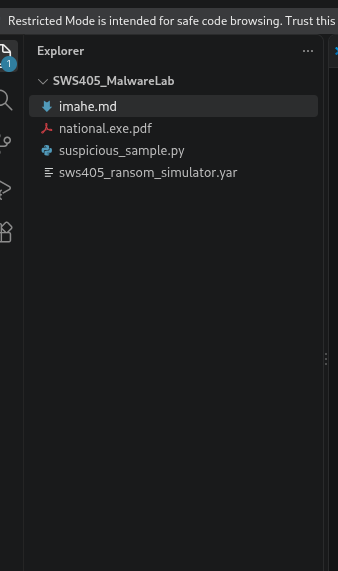

### 3.2 Tool installation

The required tools (file, coreutils, binutils, yara, strace and tcpdump) were installed with `apt`. The version checks confirmed that YARA 4.5.8 and strace 7.2 were installed and working.

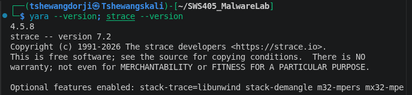

## 4. Part A – Static Analysis

The sample was not executed during this part.

### 4.1 File identification

The `file` command was run on the sample and on `national.exe.pdf`. Both files were identified as Python scripts (text), not as a PDF document or a Windows executable. The name `national.exe.pdf` had two misleading extensions, which showed that a file extension cannot be trusted as proof of file type.

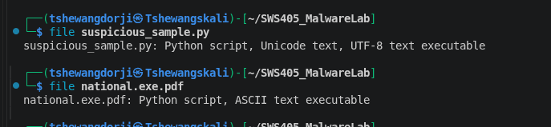

### 4.2 Hashing

The MD5, SHA-1 and SHA-256 hashes of the sample were calculated. The SHA-256 value was saved to `sample_hash_before.txt`, and `sha256sum -c` reported `OK`, which confirmed the baseline.

| Algorithm | Value |
| --- | --- |
| MD5 | `29feb123f1f062328b746b1fdb332612` |
| SHA-1 | `b91aa1f51901d2fa48ef83b84c8ef34389ccc10e` |
| SHA-256 | `7ef94bfb15c7479e209a701b40cf6994a2f9c4b0870b4576966b43050554bc26` |

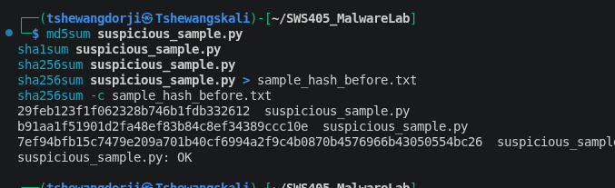

### 4.3 Strings analysis

The `strings` command was used to extract readable text from the sample. The output contained suspicious-looking strings such as `SIMULATED_RANSOM_NOTE`, `YOUR FILES ARE LOCKED`, `FILE_READ`, `NOTE_CREATE`, `LOG_WRITE` and `lab_workspace`. These suggested that the program read files, wrote a ransom-note-like message and created a log inside a folder named `lab_workspace`. The strings also included the statement that no files had been encrypted. Strings alone could not prove these behaviours, so they were treated as hypotheses to be tested dynamically.

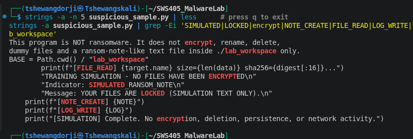

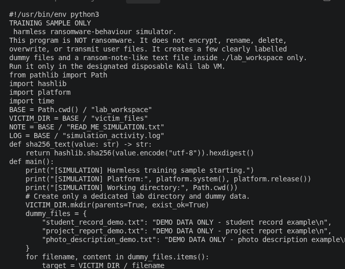

### 4.4 Hexadecimal inspection

The first 128 bytes of the sample were viewed with `xxd`. The file began with the bytes `23 21 2f 75 73 72 2f 62 69 6e 2f 65 6e 76 20 70 79 74 68 6f 6e 33`, which read as `#!/usr/bin/env python3`. The file did not begin with the `MZ` signature (`4d 5a`) of a Windows PE executable, so it was confirmed to be a text script and not a PE file.

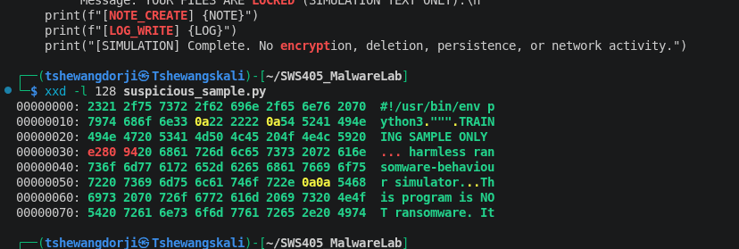

### 4.5 YARA pattern matching

The sample was scanned with the supplied YARA rule using `yara -s`. The rule `SWS405_Harmless_Ransomware_Simulator` matched. All three markers were found, although the rule only required two of them.

| String | Offset | Matched text |
| --- | --- | --- |
| `$marker1` | 0x82f | SIMULATED_RANSOM_NOTE |
| `$marker2` | 0x85a | YOUR FILES ARE LOCKED |
| `$marker3` | 0xa88 | No encryption, deletion, persistence |

This showed pattern-based classification of a known training sample. It did not prove that every file matching a rule is malicious, because real rules must be tested for false positives and false negatives.

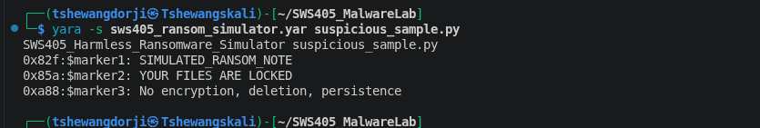

### 4.6 Static analysis worksheet

| Question | Student observation | What it means |
| --- | --- | --- |
| What was the real file type? | Python script, UTF-8 text, with no MZ header | The sample was a text script, not a Windows executable. The extension was not proof of type. |
| What was the SHA-256 hash? | `7ef94bfb15c7479e209a701b40cf6994a2f9c4b0870b4576966b43050554bc26` | A unique fingerprint of this exact file, used to verify that it stayed unchanged. |
| Which suspicious strings were found? | SIMULATED_RANSOM_NOTE, YOUR FILES ARE LOCKED, FILE_READ, NOTE_CREATE, LOG_WRITE, lab_workspace | The strings suggested ransom-note-like behaviour and file activity. |
| What file operations were suggested? | Creating a directory and files, reading files, writing a note and a log | These were predictions to be tested during dynamic analysis. |
| Did YARA match? Which strings matched? | Yes. All three markers matched (0x82f, 0x85a, 0xa88). | The sample matched the known training pattern. |
| What behaviour should be monitored dynamically? | File creation, reading and writing, process execution, and network connections | These were the behaviours implied by the static findings. |

## 5. Part B – Dynamic Analysis

The sample was executed once in the controlled VM while monitoring was active.

### 5.1 Baseline

Before execution, `ls -la lab_workspace` reported that the directory did not exist. A file list of the lab folder was saved to `baseline.txt`. It contained the sample, the YARA rule, `national.exe.pdf`, the hash file and some unrelated screenshot and note files, but no `lab_workspace` output.

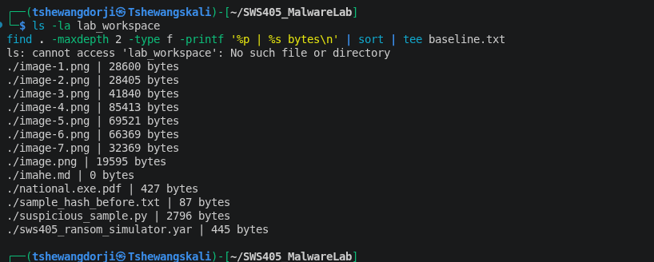

### 5.2 Process monitoring

A process monitor (`watch` with `ps`) was started in a second terminal before the sample was run. The sample was short-lived, so it may have finished between refreshes of the monitor, which was expected.

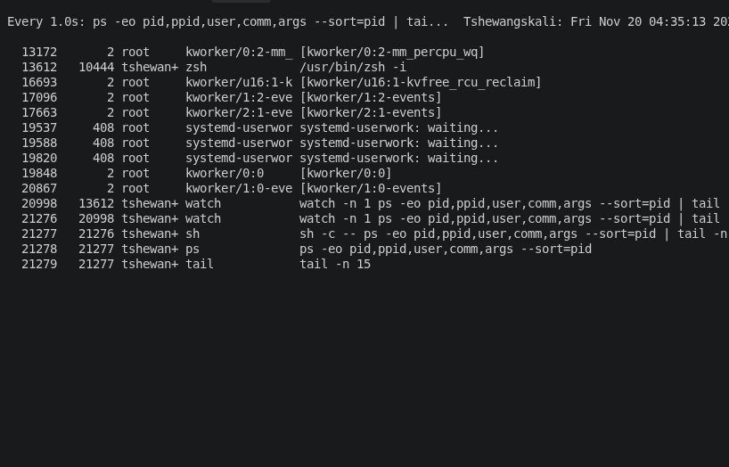

### 5.3 System call tracing with strace

The sample was run under strace with `-f -o dynamic_trace.txt -e trace=%file,%process,%network`. The program printed that it was a harmless training sample. It reported `[FILE_CREATE]` for three dummy files, `[FILE_READ]` for the same three files, `[NOTE_CREATE]` for the simulated note and `[LOG_WRITE]` for the log, and finished with a message that there was no encryption, deletion, persistence or network activity.

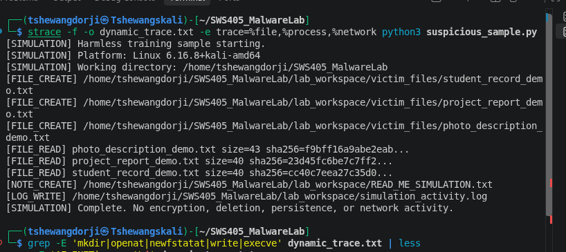

The trace file was then inspected. Filtering on the `lab_workspace` path showed the key system calls:

| System call | Meaning |
| --- | --- |
| `execve("/usr/bin/python3", ["python3", "suspicious_sample.py"])` | The sample was launched through Python. |
| `mkdir(.../lab_workspace/victim_files)` returned ENOENT, then `mkdir(.../lab_workspace)` and a second `mkdir(.../victim_files)` succeeded | The folders were created. The first call failed only because the parent folder did not yet exist. |
| `openat(... student_record_demo.txt, O_WRONLY\|O_CREAT\|O_TRUNC)`, and the same for `project_report_demo.txt` and `photo_description_demo.txt` | The three dummy files were created. |
| `openat(... victim_files/, O_DIRECTORY)` and three `openat(..., O_RDONLY)` calls | The folder was listed and the dummy files were read. |
| `openat(... READ_ME_SIMULATION.txt, O_WRONLY\|O_CREAT\|O_TRUNC)` | The simulated ransom note was written. |
| `openat(... simulation_activity.log, O_WRONLY\|O_CREAT\|O_APPEND)` | The log was opened in append mode. |

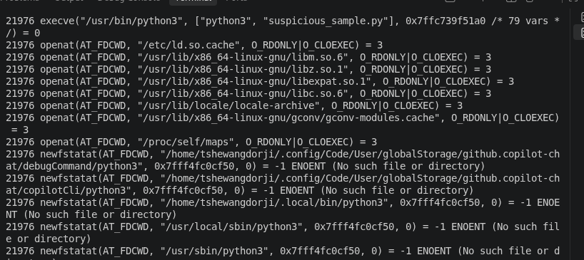

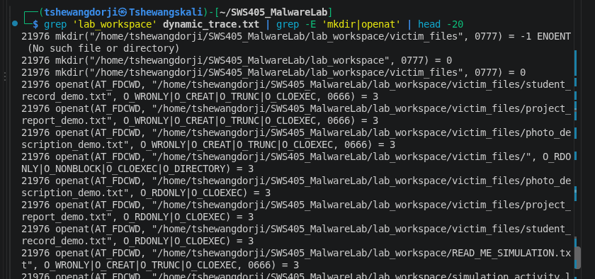

A search of the trace for `AF_INET` and `connect(` returned no matches (exit code 1), so no network connection was made by the sample during this run.

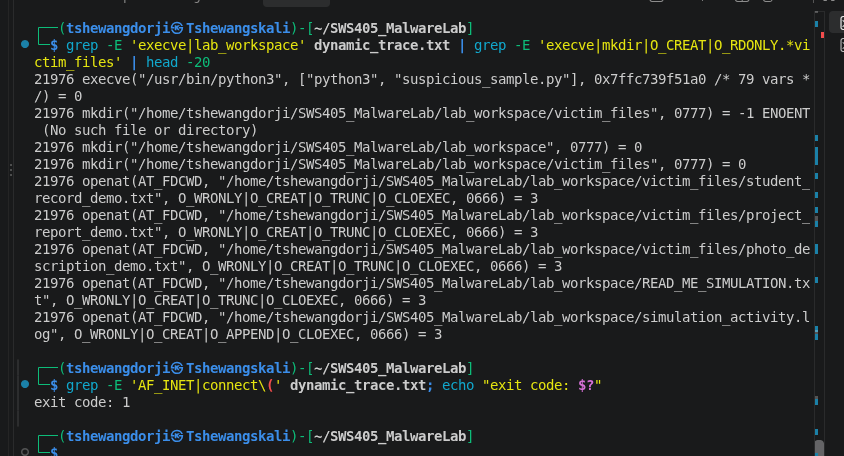

### 5.4 Created files

After execution, `lab_workspace` contained five files: three dummy files in `victim_files` (40, 40 and 43 bytes), `READ_ME_SIMULATION.txt` (254 bytes) and `simulation_activity.log` (71 bytes). The note stated that no files had been encrypted, and the dummy files remained readable plain text. The log contained one entry whose `sha256_marker` value (`e60c4ba0c5a5e008`) matched the first 16 characters of the SHA-256 hash of the note.

| File | SHA-256 |
| --- | --- |
| `victim_files/photo_description_demo.txt` | `f9bff16a9abe2eab16e94cfcd2fcc7dc7dd36b94277684e09e7f7f7dbcd1739f` |
| `victim_files/project_report_demo.txt` | `23d45fc6be7c7ff289cccbcd995d4562bd1fc37e69908d780b6e7133e8e56ca1` |
| `victim_files/student_record_demo.txt` | `cc40c7eea27c35d0e1c94f988b189e4b13aab70abb310cefc6319ccd25f3861d` |
| `READ_ME_SIMULATION.txt` | `e60c4ba0c5a5e008c3a2aef7986bdba214b08cb17917a84f2b3e0a25254edd8e` |

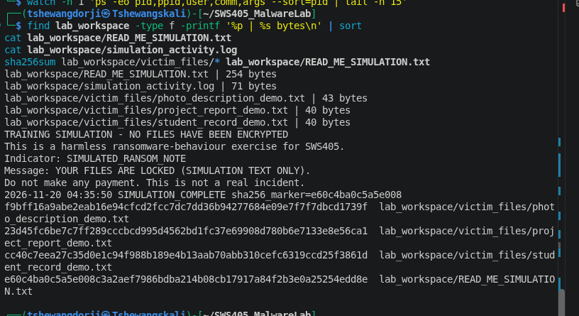

### 5.5 Network state

The `ss -tunap` command listed the active sockets. The only established outbound connections belonged to Firefox and VS Code (port 443), and no `python3` process held a socket. The listening ports belonged to services that were already running on Kali. The VM was connected through a wireless interface and not isolated on a host-only network, so these unrelated connections were present as background activity. The empty network search of the strace output was therefore the stronger evidence that the sample made no network connection.

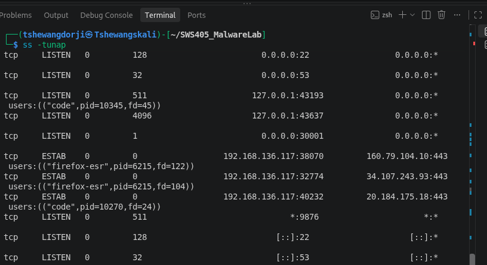

### 5.6 Integrity verification

After the exercise, the sample hash was checked again with `sha256sum -c sample_hash_before.txt`, which returned `OK`. This confirmed that the sample was not modified during the analysis.

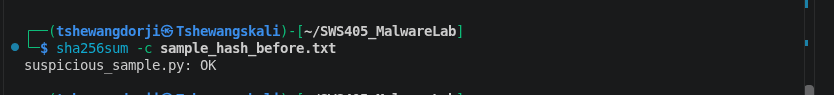

## 6. Static versus Dynamic Findings

| Static observation / prediction | Dynamic evidence | Conclusion |
| --- | --- | --- |
| Strings included FILE_CREATE and lab_workspace | `[FILE_CREATE]` messages were printed and strace showed `mkdir` and `openat` with `O_CREAT` in `lab_workspace` | Prediction confirmed |
| Strings included YOUR FILES ARE LOCKED | The note file contained this text together with the words "simulation text only" | The ransom-note wording was simulated |
| The code contained file-reading logic | `[FILE_READ]` messages were printed and strace showed `openat` with `O_RDONLY` on the dummy files | File access was observed |
| No network indicators were expected | The strace search for `AF_INET` and `connect` returned nothing, and no python3 socket appeared in `ss` | No network activity was observed in this run |
| No encryption routine was implemented | The dummy files remained unchanged readable text | No encryption was observed |

## 7. Indicators of Compromise (Training Indicators)

The following indicators were recorded. They are training indicators for a simulation and do not represent a real infection.

| Indicator | Value |
| --- | --- |
| Sample name | `suspicious_sample.py` |
| File type | Python text script |
| SHA-256 | `7ef94bfb15c7479e209a701b40cf6994a2f9c4b0870b4576966b43050554bc26` |
| MD5 | `29feb123f1f062328b746b1fdb332612` |
| YARA rule match | `SWS405_Harmless_Ransomware_Simulator` (3 of 3 markers) |
| Created directory | `./lab_workspace/victim_files/` |
| Created dummy files | `student_record_demo.txt`, `project_report_demo.txt`, `photo_description_demo.txt` |
| Created note | `./lab_workspace/READ_ME_SIMULATION.txt` |
| Created log | `./lab_workspace/simulation_activity.log` |
| Process behaviour | `python3` executed the script and made file-system calls only |
| Network activity | None observed during this run |

## 8. Answers to Practical Questions

**Why should an examiner use `file` rather than trust a filename extension?**

A filename extension is only part of the name and can be changed by anyone, so it does not describe the real content. The `file` command inspects the actual content, such as magic bytes and structure. In this practical, `national.exe.pdf` carried both an .exe and a .pdf extension, but `file` showed that it was a Python text script.

**What is the difference between a filename and a cryptographic hash?**

A filename is a label that can be renamed without changing the content. A cryptographic hash is a fingerprint calculated from the exact bytes of the file, so any change in the content produces a different hash, while renaming the file does not. This was demonstrated by the integrity check, where the unchanged SHA-256 value proved that the sample had not been modified.

## 9. Conclusion

Static analysis identified the sample as a Python text script and produced a hash, suspicious strings and a YARA match that suggested ransom-note-like file activity. Dynamic analysis confirmed those predictions: the sample created a folder, three dummy files, a simulated ransom note and a log, and read the dummy files. No encryption, deletion, renaming or network activity was observed, and the sample hash was unchanged at the end. The practical showed that static findings give useful hypotheses and that dynamic observation is needed to confirm what a program actually does. After the practical, the VM was to be reverted to the clean snapshot.